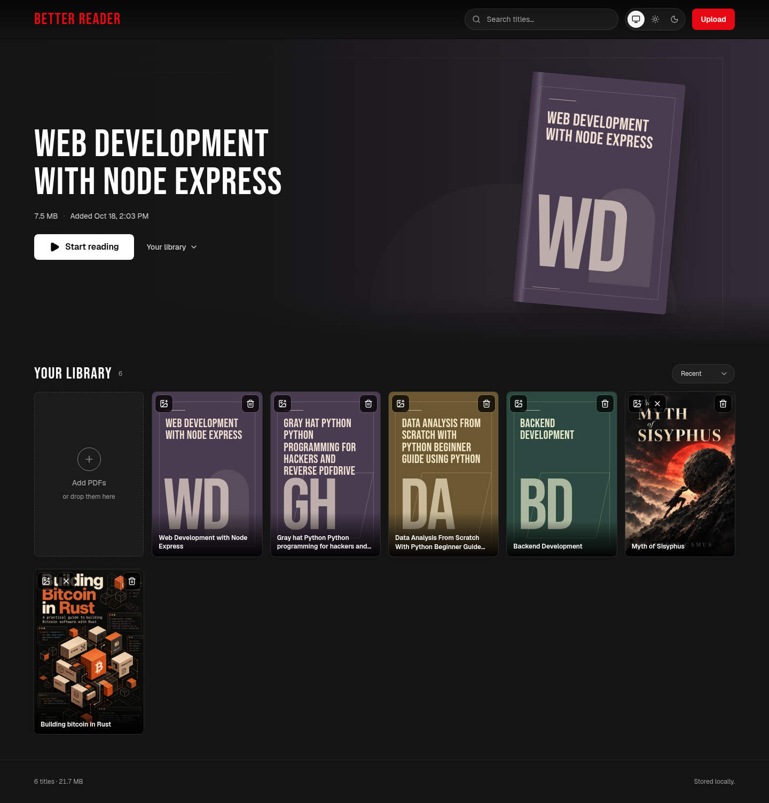
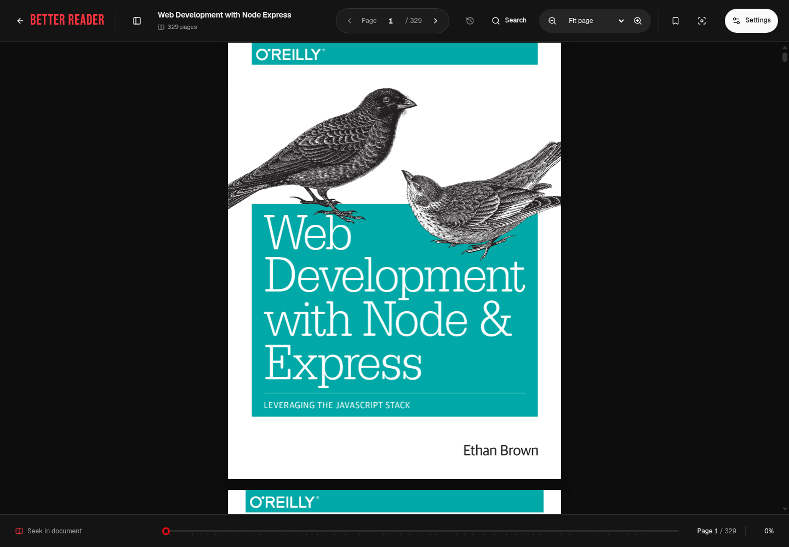
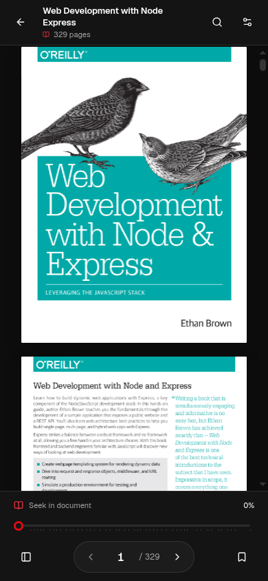

<!-- prettier-ignore -->
<div align="center">


# Better Reader

_A personal PDF library and browser reader that remembers your place._

[](https://bun.sh)
[](https://nodejs.org)
[](https://nextjs.org)
[](https://www.typescriptlang.org)
[](#checks)

[Features](#features) · [Getting started](#getting-started) · [Data and backups](#data-and-backups) · [Configuration](#configuration) · [Checks](#checks)

</div>

Better Reader is a self-hosted, single-user PDF library. Uploads stay on the server's disk, PDF.js reads them in your browser, and the original files are never rewritten. Reading progress, bookmarks, and per-book settings are saved in that browser.

> [!WARNING]
> Better Reader has no login. Anyone who can reach it can read, upload, or delete PDFs. Put it behind authentication before exposing it beyond a trusted machine or network. The Host guard helps block DNS-rebinding requests; it is not authentication.

## Features

### Library

- Upload multiple PDFs by file picker or drag-and-drop, with upload progress and per-file results.
- Add, replace, or remove cover art. Books without covers get generated poster artwork.
- Search by filename or displayed title; sort by recent or name.
- Delete books with a 30-day undo window.

### Reader

- Continuous scrolling by default, with optional single-page and desktop two-page spread layouts.
- Resume fractional page position, bookmark pages, and keep layout, sizing, crop, and paper settings per book.
- Search document text with highlighted results, browse the table of contents or thumbnails, and seek by chapter.
- Pinch, double-tap, and Ctrl-wheel zoom; focus mode, fullscreen, and keyboard shortcuts.
- Original, dimmed, sepia, and dark paper modes. Text search does not include OCR, so scanned image-only pages are not searchable.

### Performance

- PDFs up to 1 MiB use normal streaming. Larger or unknown-size files use on-demand byte ranges.
- A shared render queue prioritizes visible pages over prefetch and thumbnails.
- Raster memory is capped: 6 MP for shown base pages, 12 MP for physical base-page reservations, 3 MP per canvas, and up to 6 MP across six high-resolution tiles.
- PDF responses support byte ranges, ETags, and conditional requests.

### Background embeddings

- Uploading or restoring a book queues server-side text extraction and local embeddings without waiting for them in the response. Existing books are checked on server startup.
- One low-priority worker process handles one job at a time. MiniLM inference uses one CPU thread, not the Next.js request process.
- Each book has its own 384-dimensional index. Passages target 150 words with 30-word overlap, stay within 256 model tokens, and retain the original PDF page number.
- No chat UI or LLM calls are included. The server helper `searchBook(id, question)` in `src/lib/ai/index.ts` returns up to ten passages with page numbers and scores, using 80% cosine similarity and 20% whole-word keyword matching. Questions must fit within 256 tokens and 2,000 characters. Future LLM callers should pass only these results as evidence.

The first text-bearing book downloads the quantized `Xenova/all-MiniLM-L6-v2` model from Hugging Face into `data/ai/models/`. Later inference uses that disk cache. Book text and questions never leave the server. Image-only pages have no extractable text; OCR is not included.

Index files are published atomically, so a partial build is never searchable. Failed jobs are logged on the server and retried on the next server startup or book restore. A worker crash does not stop uploads or reading; subsequent jobs start a new worker. Missing, corrupt, or outdated indexes are rebuilt. Interrupted builds restart from the beginning of the book.

## Screenshots

Captured from the app running locally on port 3000.

### Library



### PDF reader





## Getting started

Use Bun 1.3.14 or newer, or Node.js 22 or newer. The commands below use Bun; browser checks and benchmarks also need Node.js 22+.

```sh
bun install
bun run dev
```

Open [http://127.0.0.1:3000](http://127.0.0.1:3000). For a production build:

```sh
bun run build
bun run start
```

Both commands bind to `127.0.0.1` by default. To use the library from another device on your LAN, bind deliberately:

```sh
bun run start -- --hostname 0.0.0.0
```

> [!CAUTION]
> This exposes the same library to your network. Only do this on a trusted network, and add proxy authentication if other people can reach the server.

## Data and backups

By default, the app stores its library under `data/` in the project directory:

| Path | Contents |
| --- | --- |
| `data/uploads/` | Original PDFs, stored byte for byte |
| `data/covers/` | Cover images |
| `data/pdfs.json` | Library index |
| `data/ai/<book-id>/index.json` | Derived text passages and embeddings for one book |
| `data/ai/models/` | Downloaded MiniLM model cache |
| `data/trash/pdfs/` and `data/trash/covers/` | Deleted files waiting for restore or purge |
| `data/trash.json` | Deleted-book metadata |

Copy `data/` to back up PDFs, covers, and the library index. Browser progress, bookmarks, theme, and reader settings are stored separately in `localStorage` and are not included in that backup. Expired trash is purged on a later delete or restore.

AI indexes stay under `data/ai/<book-id>/` during the same 30-day trash window, but deleted books cannot be searched. Undo reuses the index, or queues a new build if one is missing. Purging an expired book also removes its AI directory, without removing the shared model cache. These indexes contain extracted book text, so protect them like the original PDFs. They can be regenerated from the PDFs if omitted from a backup.

## Configuration

| Variable | Purpose |
| --- | --- |
| `BETTER_READER_DATA_DIR` | Use a different persistent directory for the library. Defaults to `./data`. |
| `BETTER_READER_ALLOWED_HOSTS` | Comma-separated Host names accepted by the API, such as `books.home.lan` behind a reverse proxy. This does not enable authentication. |
| `READER_URL` | Base URL of the running server for browser checks and benchmarks. |
| `READER_PDF_ID` | Existing PDF ID used by reader browser checks. |
| `READER_PDF_IDS` | Comma-separated PDF IDs used by the benchmark. |

## Checks

Run the unit tests, lint, and production build with:

```sh
bun test
bun run lint
bun run build
```

The browser checks need a running production server, Node.js 22+, Chromium, and an existing PDF in the library. `test:reader` also needs the `agent-browser` CLI. They use a disposable browser profile and do not upload or delete library files.

```sh
# Terminal 1
bun run start -- --port 3100

# Terminal 2
READER_URL=http://127.0.0.1:3100 READER_PDF_ID=your-pdf-id bun run test:reader
READER_URL=http://127.0.0.1:3100 READER_PDF_ID=your-pdf-id bun run test:reader:interactions
READER_URL=http://127.0.0.1:3100 READER_PDF_IDS=pdf-id-1,pdf-id-2 bun run benchmark:reader
```

The checks cover reader navigation, layouts, persistence, search, gestures, accessibility, and rendering limits. See [docs/reader-performance.md](docs/reader-performance.md) for browser requirements, benchmark options, and measured results. Throttled Chromium results are not measurements from a physical phone.

## Deployment

Better Reader needs one long-running server process and a persistent, writable disk. Run only one process against a given data directory because JSON mutations are serialized within a process, not across processes. Serverless hosts or deployments that discard local files are not suitable. If a reverse proxy uses a custom hostname, add it to `BETTER_READER_ALLOWED_HOSTS` and configure authentication at the proxy.

## Architecture

| Part | Responsibility |
| --- | --- |
| `src/app/` | Next.js pages and PDF API routes |
| `src/lib/pdf-store/` | JSON index, PDF and cover files, soft-delete and restore |
| `src/lib/ai/` | Local embedding worker, per-book indexes, and server-only evidence retrieval |
| `src/instrumentation.ts` | Queues unfinished or missing indexes on server startup |
| `src/components/library/` | Library data flow, upload, search, cards, covers, and feedback |
| `src/components/reader/` | PDF.js reader, navigation state, virtualized rendering, search, and settings |
| Browser `localStorage` | Theme and per-book progress, bookmarks, and preferences |

The server serves original PDFs directly to PDF.js. The reader requests byte ranges as needed; it does not copy or rewrite a document to open it.

Keep `src/lib/ai/*.mjs` and installed dependencies alongside the production build. The worker runs those files directly with Node.js, outside Next.js bundling. Automated unit tests do not download models or launch automatic indexing workers.
